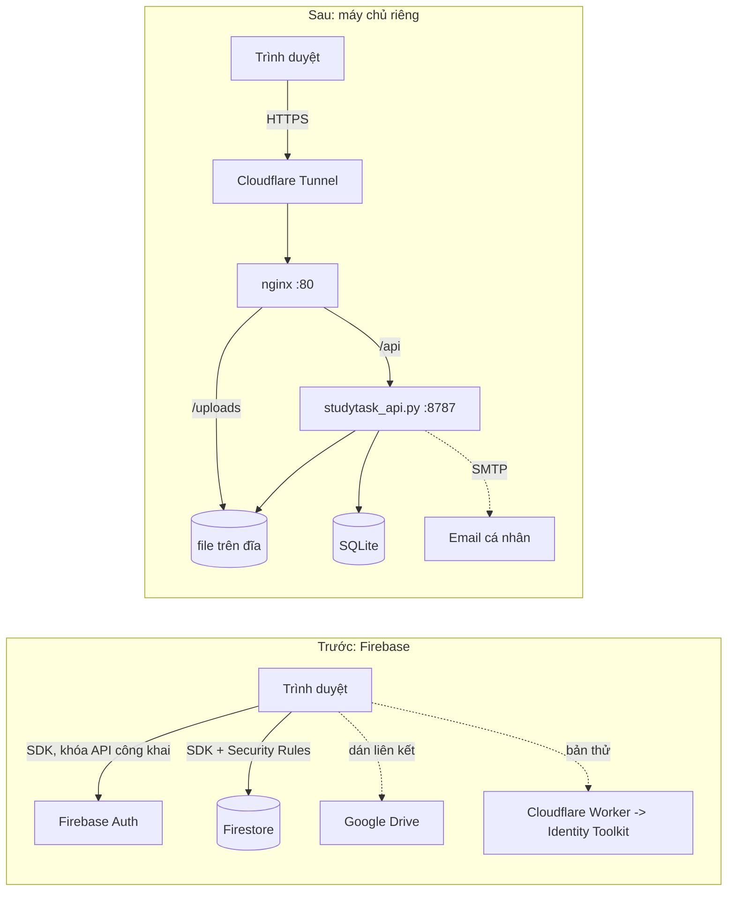

# Thiết kế 06. Chuyển lưu trữ và xác thực từ Firebase sang máy chủ riêng

- **Ngày:** 04/11/2026 (làm từ 03/11)
- **Người thực hiện:** Trương Thanh Vui
- **Công cụ AI:** Claude Code (Claude Sonnet 5.5, `claude-sonnet-5-5`).
- **Liên quan:** [D3] `docs/phan-tich/03-giu-bo-sua-them.md` (mục 1, 4, 10, 11, 15), `04-thu-cloudflare-worker-dat-lai-mat-khau.md`, kế hoạch tuần 5 (việc 3, 4, 5).
- **Trạng thái:** đã triển khai và đang chạy tại https://sutdytask.io.vn. ; tài liệu này là cơ sở để nhóm tiến hành và giảng viên xem xét.

---

## 1. Tóm tắt

Từ 03/11/2026, StudyTask không còn dùng Firebase Authentication và Cloud Firestore. Toàn bộ đăng nhập, phân quyền và lưu trữ dữ liệu chạy trên một máy chủ Ubuntu của nhóm:

- Một API viết bằng Python, chỉ dùng thư viện chuẩn (`server/studytask_api.py`, 857 dòng, 23 tuyến);
- Cơ sở dữ liệu SQLite (một tệp), file người dùng tải lên lưu trên đĩa;
- Nginx phục vụ giao diện và file, Cloudflare Tunnel đưa ra Internet.

Giao diện (React UMD, không build) giữ nguyên cấu trúc. `utils/firebase.js` vẫn giữ tên và các hàm xuất ra như cũ để các trang không phải sửa import, nhưng bên trong đã gọi `/api` thay cho Firebase SDK. Tên tệp sẽ được đổi ở một đợt riêng.

Cùng đợt này nhóm bổ sung các chức năng mà Firebase gói miễn phí không làm được hoặc cần trả phí: tải file lên máy chủ, nộp bài theo định dạng giáo viên chọn, ảnh đại diện, email cá nhân để khôi phục mật khẩu, và chat hỗ trợ thời gian thực.

---

## 2. Vấn đề của mã nguồn trước khi chuyển

Các số liệu dưới đây lấy từ commit `d2941c8` (master trước đợt chuyển). Mọi người có thể tự kiểm tra bằng lệnh ghi ở cột cuối.

| # | Vấn đề (mã trong [D3]) | Bằng chứng trong mã cũ | Kiểm chứng |
|---|---|---|---|
| 1 | Mật khẩu được lưu lại để Quản trị viên xem và đặt lại (V1) | `utils/firebase.js:150–170` ghi mật khẩu vào `userSecrets/{uid}` và đọc lại bằng `getAllSecrets`; `components/AccountManager.js:35` hiển thị `user.password` trên màn hình | `git show d2941c8:utils/firebase.js \| sed -n 148,172p` |
| 2 | Đổi mật khẩu người khác bằng cách đăng nhập ngầm | `firebase.js:192–200` khởi tạo một app Firebase phụ, đăng nhập bằng mật khẩu cũ đã lưu rồi `updatePassword`; `createAccountSecondary` (dòng 124–127) cũng dùng app phụ | `git show d2941c8:utils/firebase.js \| sed -n 120,130p` |
| 3 | Mật khẩu tài khoản demo nằm trong mã công khai | `utils/constants.js:4–8` có `admin123`, `teacher123`, `student123`, `daotao123`, `taichinh123`; mã này được trình duyệt tải về | `git show d2941c8:utils/constants.js \| sed -n 3,9p` |
| 4 | Phân quyền chỉ dựa vào Security Rules chạy ở phía Google | `firestore.rules` 145 dòng; để tin được các rule này nhóm phải viết 46 + 69 ca kiểm thử và 113 bản đột biến (báo cáo tuần 4). Người dùng tự sửa `role` (V2), đọc `activities` của người khác (V4) từng xảy ra ở bản cũ | `npm run test:rules`, `npm run test:rules:deep` |
| 5 | Không có chỗ lưu file | Tài liệu và biểu mẫu chỉ là liên kết ngoài. Trên bản đang chạy có 15 liên kết `drive.google.com` trong dữ liệu mẫu; mục 15 của [D3] ("Nộp tệp trực tiếp") chưa làm được | `git grep -c "drive.google" d2941c8 -- utils/constants.js` |
| 6 | Quên mật khẩu phải dựa vào Worker thử | `reset-worker/` gọi Identity Toolkit; tài liệu 04 ghi rõ chưa có giới hạn tần suất, chưa chốt phương án | `docs/thiet-ke/04-...md` |
| 7 | Liên hệ hỗ trợ chỉ là biểu mẫu lưu trong `localStorage` | `pages/Contact.js` cũ: tin nhắn không bao giờ đến Quản trị viên (V5) | `git show d2941c8:pages/Contact.js \| head -60` |

Để vá V1 và V2 triệt để, [D3] mục 11 đề xuất Cloud Functions và Admin SDK, và mục 15 đề xuất Firebase Storage. Đây là điểm quyết định dẫn tới tài liệu này.

---

## 3. Lý do chuyển đổi

**3.1. Loại bỏ hẳn việc lưu mật khẩu đọc được (V1, V2, mục 3 ở bảng trên).**
Trên máy chủ, mật khẩu chỉ tồn tại dưới dạng băm PBKDF2-HMAC-SHA256, 200.000 vòng lặp, salt ngẫu nhiên 16 byte cho từng tài khoản. Không có cột hay bảng nào lưu mật khẩu gốc, và không còn tính năng "xem mật khẩu" của Quản trị viên. Quản trị viên đặt lại mật khẩu trực tiếp qua `POST /api/admin/users/{uid}/password` (không cần đăng nhập ngầm), và người dùng tự khôi phục bằng mã gửi tới email cá nhân. Mật khẩu demo đã được bỏ khỏi mã công khai (`utils/constants.js` chỉ còn giá trị `demo` cho chế độ offline cục bộ).

**3.2. Nghiệp vụ nhạy cảm chạy ở máy chủ, không phụ thuộc gói trả phí.**
Theo tài liệu Firebase, Cloud Functions chỉ dùng được khi dự án ở gói Blaze, tức phải bật thanh toán bằng thẻ ([Firebase Codelab](https://firebase.google.com/codelabs/firebase-cloud-functions), [Quotas and limits](https://firebase.google.com/docs/functions/quotas)). Cloud Storage for Firebase cũng yêu cầu Blaze từ 03/02/2026 ([FAQ của Firebase](https://firebase.google.com/docs/storage/faqs-storage-changes-announced-sept-2024)). Blaze vẫn có hạn mức miễn phí, nhưng nhóm sinh viên không có nguồn thanh toán ổn định, và hai mục [D3] 11 và 15 đều cần gói này. Máy chủ riêng của nhóm đã có sẵn (Intel Core i3-9100F, RAM 7,2 GB, đĩa 465 GB) nên chi phí thêm bằng 0 ngoài điện và tên miền. _(Các điều kiện gói của Firebase có thể thay đổi; cần đối chiếu lại trang chính thức khi nộp báo cáo.)_

**3.3. Một nơi kiểm tra quyền, dễ đọc và dễ kiểm thử.**
Toàn bộ luật phân quyền nằm trong hàm `can()` của `server/studytask_api.py`, chuyển trực tiếp từ `firestore.rules` (cùng 5 vai trò, cùng tập collection; collection lạ bị từ chối). Việc kiểm tra file tải lên, giới hạn số lần đăng nhập sai, kiểm tra Origin, kiểm tra nội dung file theo "magic bytes" đều nằm cùng một chỗ, và có thể chạy test bằng `python3` mà không cần Emulator hay Java.

**3.4. Làm được các chức năng đã nằm trong kế hoạch.**
Với máy chủ riêng, các mục sau làm được ngay trong tuần 5, trong cùng một tiến trình:

| Mục [D3] | Chức năng | Cách làm trên máy chủ |
|---|---|---|
| 15 | Nộp tệp trực tiếp, không dùng Drive | `POST /api/upload`; file lưu `/var/lib/studytask/uploads`, nginx phục vụ `/uploads/` |
| (mới) | Giáo viên chọn định dạng file được nộp | Trường `allowedExts` của bài tập; máy chủ từ chối đuôi sai và nội dung không khớp đuôi |
| 10 | Liên hệ hỗ trợ có người nhận | Chat một-một với Quản trị viên, đẩy tin tức thời qua Server-Sent Events, thông báo cho Quản trị viên đang online |
| 4 | Bỏ instance Firebase phụ | Không còn Firebase SDK ở trình duyệt |
| (mới) | Email cá nhân khôi phục mật khẩu | Mã 6 số, hiệu lực 15 phút, tối đa 5 lần nhập sai |

**3.5. Chủ động về dữ liệu và sao lưu.**
Dữ liệu nằm trong một tệp SQLite và một thư mục file; sao lưu là sao chép hai thứ này. Nhóm cũng không bị giới hạn bởi quota đọc/ghi của gói miễn phí.

---

## 4. Kiến trúc trước và sau



Đường đi của một yêu cầu: trình duyệt → Cloudflare (HTTPS) → cloudflared trên máy chủ → nginx → `/api/*` chuyển tới API Python (chỉ nghe `127.0.0.1:8787`, không mở ra mạng ngoài).

### 4.1. Ánh xạ chức năng Firebase sang máy chủ

| Firebase | Thay bằng | Ghi chú |
|---|---|---|
| `signInWithEmailAndPassword` | `POST /api/auth/login` | Tên đăng nhập + mật khẩu; cookie phiên `HttpOnly`, `SameSite=Lax` |
| `onAuthStateChanged` | `GET /api/auth/me` + cookie | Phiên lưu ở bảng `sessions`, hạn 30 ngày |
| `createUserWithEmailAndPassword` (app phụ) | `POST /api/admin/users` | Chỉ Quản trị viên |
| `updatePassword` (đăng nhập ngầm) | `POST /api/admin/users/{uid}/password`, `POST /api/auth/change-password` | Đặt lại mật khẩu đăng xuất mọi phiên cũ |
| `sendPasswordResetEmail`, Worker thử | `POST /api/auth/forgot` + `POST /api/auth/reset` | Mã 6 số gửi qua SMTP |
| Firestore `getDoc/setDoc/getDocs/deleteDoc` | `GET/PUT/DELETE /api/doc/{collection}/{id}` | Bảng `docs(col, id, data JSON)`; `merge` như `setDoc(..., {merge:true})` |
| `arrayUnion` | `POST /api/doc/{col}/{id}/append` | Dùng cho nhật ký hoạt động |
| `firestore.rules` | hàm `can(op, col, id, user, old, new)` | Cùng điều kiện, kể cả "chủ tài khoản chỉ được sửa `name`, `phone`" |
| Firebase Storage | `POST /api/upload`, `POST /api/account/avatar` | Danh sách đuôi cho phép, giới hạn dung lượng, kiểm tra nội dung |

`firestore.rules` và các bài test rules **vẫn được giữ** trong repo làm đặc tả tham chiếu cho `can()`, và CI vẫn chạy chúng.

---

## 5. Bảo mật sau khi chuyển

| Hạng mục | Cách làm |
|---|---|
| Lưu mật khẩu | PBKDF2-HMAC-SHA256, 200.000 vòng, salt 16 byte riêng từng tài khoản; so sánh bằng `hmac.compare_digest` |
| Phiên | Mã ngẫu nhiên 32 byte, cookie `HttpOnly; SameSite=Lax; Secure` (khi qua HTTPS); đổi/đặt lại mật khẩu thì hủy mọi phiên |
| Chống dò mật khẩu | Tối đa 10 lần đăng nhập sai trong 5 phút cho mỗi địa chỉ IP; tính thời gian băm ngay cả khi tên đăng nhập không tồn tại |
| CSRF | Mọi yêu cầu ghi kiểm tra `Origin` phải trùng `Host` |
| Phân quyền | `can()` theo vai trò `admin / teacher / training / finance / student`; collection lạ bị từ chối |
| File tải lên | Danh sách đuôi cho phép; giới hạn 25 MB (giáo viên) và 15 MB (sinh viên); sinh viên chỉ nộp đúng định dạng giáo viên chọn và đúng môn mình học; kiểm tra "magic bytes" (PDF, DOCX, ảnh...); tên file lưu có chuỗi ngẫu nhiên; nginx gắn `X-Content-Type-Options: nosniff` |
| Khôi phục mật khẩu | Mã 6 số băm SHA-256, hiệu lực 15 phút, nhập sai quá 5 lần thì hủy; phản hồi giống nhau dù tài khoản có tồn tại hay không; giới hạn số lần yêu cầu gửi mã |
| Email cá nhân | Lưu ở bảng riêng, không nằm trong hồ sơ nên người khác (kể cả Quản trị viên) không đọc được qua API; liên kết hoặc gỡ phải nhập lại mật khẩu |
| Mã công khai | `docs/`, `tests/`, `README.md`, `firestore.rules`... không nằm trong thư mục web của máy chủ; script triển khai chỉ chép `app.js`, `index.html`, `style.css`, `components/`, `pages/`, `utils/` |

---

## 6. Bằng chứng

### 6.1. Kiểm thử tự động

| Bộ kiểm thử | Lệnh | Nội dung | Số kiểm tra |
|---|---|---|---|
| Chuyển tài khoản email → tên đăng nhập | `python3 tests/server/test_migrate.py` | Tạo CSDL theo lược đồ cũ; kiểm tra tên đăng nhập sinh ra, mật khẩu cũ vẫn dùng được, có bản sao lưu, hồ sơ bỏ trường email | 8 |
| Tài khoản, email cá nhân, quên mật khẩu, ảnh đại diện, chat | `python3 tests/server/test_account.py` | Mã xác nhận đúng/sai/dùng lại; đặt lại mật khẩu đăng xuất phiên cũ; ảnh giả bị chặn; tin nhắn đến Quản trị viên và người dùng **qua SSE ngay lập tức**; người dùng không đọc được hội thoại của người khác | 46 |
| Tạo và đăng nhập theo tên đăng nhập | `python3 tests/server/test_users.py` | Tên sai định dạng, trùng, mật khẩu ngắn; **mật khẩu không xuất hiện dạng văn bản trong tệp cơ sở dữ liệu** | 13 |
| Nộp bài theo định dạng | `bash tests/server/test_submit.sh` | `.txt`/`.exe` bị chặn khi bài chỉ nhận PDF/Word; file giả đuôi bị chặn; sinh viên môn khác bị chặn | 10 |
| Logic, Security Rules (đã có từ trước) | `npm run test:logic`, `test:rules`, `test:rules:deep` | Tính điểm, học phí; 46 + 69 ca rules | 42 + 46 + 69 |

Tổng cộng 77 kiểm tra mới cho máy chủ. Các bộ test đã chạy thành công trên máy chủ ngày 03–04/11/2026 (test_account 47/47, test_users 13/13, test_migrate 9/9, test_submit 10/10). Sau đó các tệp được đưa vào repo: đổi sang đường dẫn tương đối, bỏ 3 kiểm tra không có nội dung thực chất và viết lại `test_migrate.py` để không cần tệp API cũ. Vì vậy số liệu "77" và kết quả cuối cùng do **CI (job `server-tests`) xác nhận lại** khi mở Pull Request.

### 6.2. Số liệu vận hành thực tế

Lấy bằng `deploy/server-report.sh` trên máy chủ lúc 03:33 UTC ngày 04/11/2026, sau 19 giờ chạy liên tục:

| Thông số | Giá trị |
|---|---|
| CPU | Intel Core i3-9100F, 4 luồng; tải khi đo 0%, load average 0,18 / 0,09 / 0,04 |
| RAM | 7,2 GB; đang dùng 655 MB; còn trống 6,6 GB; swap chưa dùng |
| Tiến trình API (`python3`) | khoảng 31 MB RSS (0,4% RAM) |
| Ổ cứng | Ổ vật lý 465,8 GB; hệ thống 295 GB, đã dùng 7,6 GB (3%) |
| Dữ liệu StudyTask | 6 MB (cơ sở dữ liệu và file tải lên) |
| Dịch vụ | `studytask-api`, `nginx`, `cloudflared` đều `active` |
| Lưu lượng | Từ lúc khởi động nhận 32 MB, gửi 37 MB; 1.036 yêu cầu web trong ngày |
| Độ trễ `GET /api/auth/me` | trung vị 526 ms (10 lần, đo từ máy phát triển qua Cloudflare) |

Lưu ý: nhóm **không có số đo tương ứng của Firebase** nên không kết luận bản mới nhanh hơn hay chậm hơn; độ trễ trên chủ yếu do đường truyền tới Cloudflare và máy chủ.

### 6.3. Quy mô mã

| Thành phần | Trước | Sau |
|---|---|---|
| Kết nối dữ liệu phía trình duyệt | `utils/firebase.js` 279 dòng, nhập Firebase SDK từ `gstatic.com` | `utils/firebase.js` 205 dòng, chỉ dùng `fetch` tới `/api` |
| Phân quyền | `firestore.rules` 145 dòng (giữ làm đặc tả) | `can()` trong `server/studytask_api.py` |
| Máy chủ | không có | `server/studytask_api.py` 857 dòng, thư viện chuẩn Python |

### 6.4. Cách tự kiểm chứng

```bash
# 1. Mật khẩu không còn ở dạng đọc được trong mã công khai
git grep -nE "admin123|teacher123|student123|daotao123|taichinh123" -- app.js components pages utils   # không có kết quả

# 2. Mã nguồn cũ có lưu mật khẩu
git show d2941c8:utils/firebase.js | grep -n "userSecrets\|getAllSecrets"

# 3. Chạy toàn bộ kiểm thử máy chủ (chỉ cần Python 3)
python3 tests/server/test_migrate.py && python3 tests/server/test_account.py && python3 tests/server/test_users.py && bash tests/server/test_submit.sh

# 4. Trên máy chủ: kiểm tra mật khẩu chỉ ở dạng băm
sqlite3 /var/lib/studytask/studytask.db "select username, substr(pwhash,1,16)||'...' from accounts"

# 5. Báo cáo thông số máy chủ
bash deploy/server-report.sh
```

---

## 7. Dữ liệu và việc chuyển đổi tài khoản

- **Dữ liệu từ Firebase production không được chuyển sang.** Nhóm chưa xuất dữ liệu Firestore của project `sutdytask`; máy chủ mới bắt đầu với dữ liệu nạp bằng script (5 tài khoản demo, môn học, lịch, tài liệu). Mật khẩu của Firebase Auth không thể xuất dưới dạng đọc được, nên người dùng thật của bản cũ sẽ phải được tạo lại tài khoản. Muốn giữ lại dữ liệu cũ, cần xuất Firestore rồi viết script nạp vào bảng `docs` (chưa làm).
- **Tên đăng nhập thay email.** Do tài khoản không còn gắn với Firebase, tên đăng nhập là một chuỗi 3–32 ký tự (`a-z`, `0-9`, `.`, `_`, `-`). Khi khởi động bản mới, máy chủ tự chuyển bảng `accounts` từ cột `email` sang cột `username` (lấy phần trước dấu `@`, thêm số nếu trùng, thêm ký tự nếu quá ngắn), giữ nguyên mật khẩu đã băm và **sao lưu trước** vào `studytask.db.bak-pre-username`. Đăng nhập bằng tên cũ dạng `xxx@studytask.vn` vẫn được chấp nhận trong thời gian chuyển tiếp.
- **Email là thông tin tùy chọn.** Người dùng có thể liên kết một email cá nhân (xác nhận bằng mã) chỉ để khôi phục mật khẩu; email không dùng để đăng nhập và không hiển thị cho người khác.

---

## 8. Hạn chế và việc còn lại

Nhóm ghi rõ các điểm chưa đạt để không hiểu nhầm phạm vi:

1. **V3 (chấm trắc nghiệm ở máy chủ) chưa làm.** Thiết kế ở tài liệu 05 vẫn là việc của tuần 6; hiện đáp án và điểm trắc nghiệm vẫn do trình duyệt xử lý.
2. **V4 mới vá một phần.** `can()` đã giới hạn đọc `activities` cho chủ tài khoản, Admin và giáo viên dạy chung ít nhất một môn, đồng thời kiểm tra sự kiện khi ghi (`tests/server/test_activities.py`). Vẫn còn: giáo viên đọc được cả tài liệu nên thấy sự kiện của các môn mình không dạy; sinh viên vẫn tự ghi được điểm trắc nghiệm đúng định dạng cho đến khi làm V3 và vẫn xóa được nhật ký của mình.
3. **Gửi email cần cấu hình SMTP.** Khi chưa cấu hình, giao diện báo "máy chủ chưa cấu hình gửi email"; hướng dẫn trong `server/README.md`.
4. **Chưa có sao lưu tự động.** Hiện chỉ có sao lưu thủ công và bản sao tự động trước khi chuyển lược đồ.
5. **Một máy chủ duy nhất.** Máy hỏng hoặc mất điện thì dịch vụ dừng; Firebase có độ sẵn sàng cao hơn. Đây là đánh đổi nhóm chấp nhận để đổi lấy quyền kiểm soát và chi phí.
6. **Tin nhắn chat lưu dạng văn bản thường** trong cơ sở dữ liệu (không mã hóa đầu cuối); chỉ Quản trị viên và người gửi đọc được qua API.
7. **File sinh viên nộp nằm trong `/uploads/submissions/`** và nginx phục vụ công khai theo đường dẫn có chuỗi ngẫu nhiên; ai biết đúng đường dẫn đều mở được. Cần chuyển sang kiểm tra đăng nhập trước khi tải nếu dùng cho bài nộp thật.
8. **Chạy cả hệ thống trên máy cá nhân** cần nginx (hoặc tương đương) để chuyển `/api` tới Python; `npm run serve` chỉ còn dùng cho chế độ `?offline=1`. Mục "Chạy ứng dụng trên máy local" trong README đã ghi rõ.
9. **Mật khẩu tài khoản demo vẫn yếu** trên máy chủ; cần đổi trước khi dùng cho người ngoài nhóm.

---

## 9. Triển khai

Chi tiết trong [server/README.md](../../server/README.md). Tóm tắt:

```bash
git clone https://github.com/NguyenThanhTung301020/Nhom-5_Studytask.git
cd Nhom-5_Studytask
sudo bash deploy/deploy.sh      # API + dịch vụ systemd + giao diện + nginx
```

Cloudflare Tunnel trỏ tên miền tới `http://localhost:80`. Script chạy lại được nhiều lần; mỗi lần chạy tạo thư mục phiên bản mới (`/v<ngày giờ>/`) để trình duyệt và Cloudflare luôn lấy mã mới thay vì bản đã cache.

---

## 10. Đối chiếu với kế hoạch tuần 5

| Việc tuần 5 | Trạng thái sau đợt chuyển |
|---|---|
| 3. Chốt phương án máy chủ | Đã triển khai; chờ ý kiến giảng viên |
| 4. Bỏ lưu mật khẩu (V1) và instance Firebase phụ | Đã bỏ trên bản đang chạy (mục 3.1, 6.4) |
| 5. Bỏ tự nạp dữ liệu mẫu (V6) | Máy chủ không tự nạp; dữ liệu mẫu chỉ nạp bằng script thủ công |
| 6. Hoàn thiện rules (V4) | Chưa (mục 8.2) |
| 7. CI | Thêm job `server-tests` vào `.github/workflows/ci.yml` |
| 8. Thiết kế Trắc nghiệm (V3) | Không thuộc đợt này |
